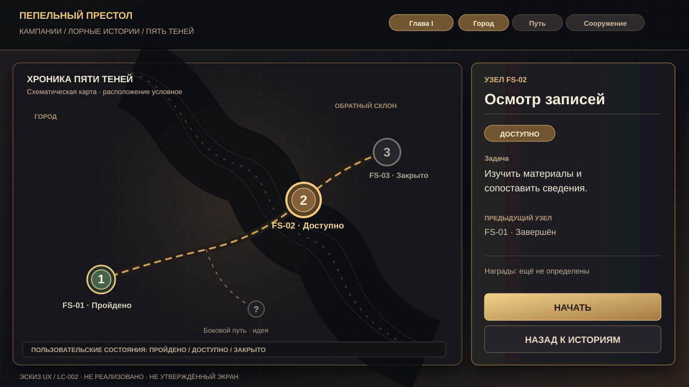
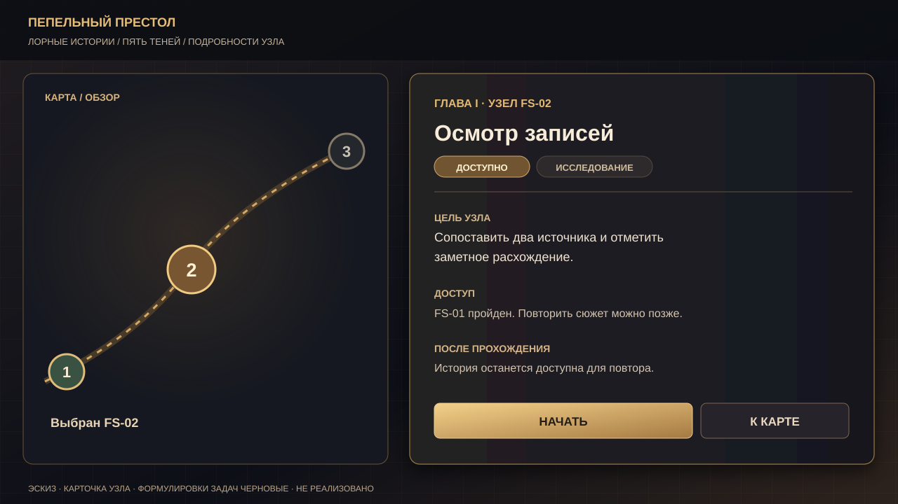
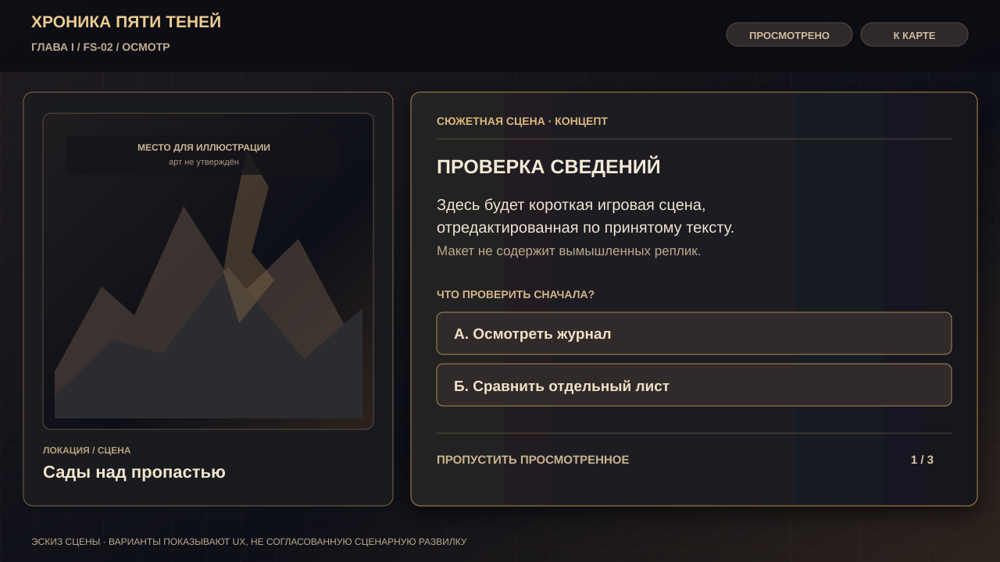
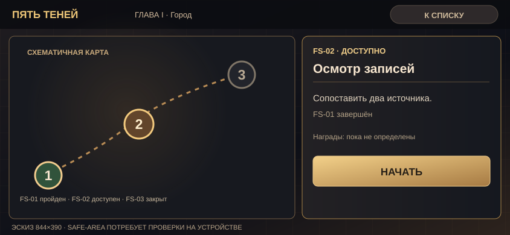

# LORE-CAMPAIGN — UX-макеты и карта экранов

**Редакция 0.1 · 14 ноября 2026 · [ПРЕДЛОЖЕНИЕ]**  
Макеты сохранены как **редактируемые SVG**, чтобы их можно было открыть в браузере, просматривать прямо в GitHub, импортировать в Figma и развивать. **Не реализованы в игре и не утверждены как окончательная верстка.** Текст интерфейса — функциональные примеры, а не утверждённые игровые диалоги.

## Исходники и предпросмотр

### 1. Карта истории — landscape 1280×720

[SVG-исходник](mockups/lore-campaign-map-landscape.svg)

**Идея:** узлы на 2D-схеме и компактная карточка справа; слои/главы сверху, статусы пройдено/доступно/закрыто различаются цветом **и подписью**. Боковая точка с «?» — иллюстрация будущей *необязательной* ветви, не новый канонический сюжет.

### 2. Подробности узла — landscape 1280×720

[SVG-исходник](mockups/lore-campaign-node-detail.svg)

**Идея:** крупная цель, условие открытия, очевидная кнопка входа и безопасный возврат. Названия/формулировки здесь не являются утверждённым сценарием.

### 3. Сюжетная сцена и выбор — landscape 1280×720

[SVG-исходник](mockups/lore-campaign-scene-dialogue.svg)

**Идея:** место для художественной иллюстрации без тяжёлого 3D, короткий фрагмент сцены, два крупных варианта, пропуск *только* уже просмотренного (без пропуска обязательного выбора). Внутренний пример вопроса/ответов иллюстрирует взаимодействие, а не литературный канон.

### 4. Компактная карта — iPhone landscape 844×390

[SVG-исходник](mockups/lore-campaign-map-compact.svg)

**Идея:** одновременная карта и карточка только при достаточной ширине; при малой высоте детали переходят в отдельное состояние, а не выталкивают кнопку за экран. **SVG демонстрирует композицию; не доказывает работу safe-area, фокуса, касания или Safari.**

## Предложенный путь игрока

`Штаб → Кампания → Кампании лора → Пять теней → Карта → Карточка узла → Сцена / задача → Результат → Карта`

- **LC-002:** обложка истории и граф узлов, статусы, блокировки, возврат, компактный слой деталей.
- **LC-003:** исполнение сцен, выбор, журнал, сохранение и повтор без изменения первого выбора.
- **LC-004:** авторски проверенный пилот FS-01–FS-03 со связным смысловым действием. Это принципиально не «три экрана с кнопкой далее».
- **Позднее:** только после решения владельца — боевые испытания, симуляция, мгновенное получение и экономические выплаты.

## Инварианты для реализации

1. Придерживаться [UI_DESIGN_SYSTEM.md](UI_DESIGN_SYSTEM.md): единый художественный язык HQ-UI-008 и ROSTER-UI-006, графит, бронза, одна сценическая оболочка, без возврата к legacy-синим панелям.
2. Сохранять точку входа `#campaignLoreContent` в существующем хабе; не добавлять новый пункт главного меню. 2D SVG/HTML без постоянной Babylon.js-сцены и новых тяжёлых зависимостей.
3. Проверять iPhone landscape **844×390 и 932×430**, короткую высоту, safe-area, область касания не менее ~44×44 CSS px, ориентацию, возврат, отсутствие горизонтальной прокрутки и конфликтов `dialog`.
4. Маркеры карты должны иметь обычный текстовый список с равнозначным доступом; `focus-visible`, клавиатурные действия, Escape и подписи состояний обязательны. При перезапуске восстанавливать положение/выбор после LC-003.
5. Отсутствие утверждённой экономики означает **нет** сумм дропа, действующих кнопок фарма, симуляции и мгновенного начисления. В макете есть только нейтральная фраза об отсутствии наград.
6. Карта — *условная визуальная схема*, а не точная география или новый канонический объект; любые окончательные названия/сцены сверять с приватным источником.
7. Нельзя считать рисунки проверенными в Safari или утверждёнными владельцем лишь потому, что SVG открывается.

## До начала LC-002

- Сверить актуальный `main` и статусы PR #316/#317/#62.
- Выбрать экранную адаптацию макета под фактический `index.html` и дизайн-токены; нельзя слепо копировать пиксели 1280×720 на мобильные 844×390.
- Снять браузерные скриншоты реального HTML/CSS после внедрения, отдельно проверить DOM-события, back, reload и разграничение старой `CampaignCore`.
- После ревью предложить владельцу выбор по итоговому арту и драматургии до превращения концепта в финальную UI-приёмку.

**См. также:** [дорожная карта](LORE_CAMPAIGN_ROADMAP_0.1.md), [текущее состояние](LORE_CAMPAIGN_PROGRESS.md), [ТЗ](LORE_CAMPAIGN_SPEC_0.1.md).
